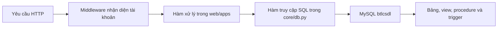

# Cơ sở dữ liệu CodeLab và các điểm truy cập từ Django

Tài liệu giải thích **31 bảng** trong lược đồ MySQL `btlcsdl` ở mã nguồn hiện tại. Có 29 bảng trong lược đồ lõi và hai bảng xác thực email. Mọi khóa học và lớp học đều miễn phí. Bảng `ThanhToan` được giữ để lưu trữ dữ liệu từ bản cài cũ. Có thể tra cứu truy vấn theo URL, hàm Python và đối tượng SQL được gọi. [Lược đồ lõi](../database/01_schema.sql) · [Lược đồ xác thực](../database/14_xac_thuc_tai_khoan.sql) · [ERD quan hệ](erd-quan-he.md)

- [1. Danh mục 31 bảng](#1-danh-mục-31-bảng)
- [2. Cách Django kết nối MySQL](#2-cách-django-kết-nối-mysql)
- [3. Backend gọi cơ sở dữ liệu ở đâu](#3-backend-gọi-cơ-sở-dữ-liệu-ở-đâu)
- [4. View, procedure và trigger](#4-view-procedure-và-trigger)
- [5. Lần theo một thao tác thực tế](#5-lần-theo-một-thao-tác-thực-tế)

## 1. Danh mục 31 bảng

**PK** là khóa chính, **FK** là khóa ngoại và **UQ** là ràng buộc duy nhất. Cột ghép trong ngoặc được xét theo cả bộ. Mũi tên cho biết bảng được tham chiếu. Các liên kết ở tên bảng dẫn đến câu lệnh `CREATE TABLE`.

### Tài khoản, vai trò và OTP (5 bảng)

| Bảng | Khóa và liên kết | Một bản ghi biểu diễn gì |
| --- | --- | --- |
| [`VaiTro`](../database/01_schema.sql#L5) | PK `ma_vai_tro`. UQ `ten_vai_tro`. | Một vai trò cùng `mo_ta`. Dữ liệu gốc có `ADMIN`, `GIANG_VIEN` và `HOC_VIEN`. Backend đọc để phân quyền và hiển thị lựa chọn khi tạo tài khoản. |
| [`NguoiDung`](../database/01_schema.sql#L11) | PK `ma_nguoi_dung`. Tên đăng nhập, email và số điện thoại có ràng buộc duy nhất riêng. | Một tài khoản với `ten_dang_nhap`, `email`, `mat_khau_hash` (bcrypt), `ho_ten`, `ngay_sinh`, `so_dien_thoai`, `trang_thai` và `ngay_tao`. Đăng nhập đọc tài khoản hoạt động. Đặt lại mật khẩu cập nhật cột hash. |
| [`NguoiDungVaiTro`](../database/01_schema.sql#L24) | PK (`ma_nguoi_dung`, `ma_vai_tro`), đồng thời là FK sang `NguoiDung` và `VaiTro`. | Một lần gán vai trò cho tài khoản, có `ngay_gan`. Cấu trúc nối nhiều–nhiều cho phép một người vừa là học viên vừa là giảng viên. |
| [`MaXacThucEmail`](../database/14_xac_thuc_tai_khoan.sql#L4) | PK `ma_yeu_cau`. UQ (`muc_dich`, `email`). FK `ma_nguoi_dung` tùy chọn → `NguoiDung` (xóa dây chuyền). | Một OTP theo email và mục đích đăng ký hoặc đặt lại mật khẩu. Lưu `ma_bam` HMAC, `het_han` theo UTC, `so_lan_sai` và `dau_mat_khau` cho luồng đặt lại. Gửi lại thay bản ghi cũ, xác thực thành công xóa bản ghi. |
| [`HanMucXacThuc`](../database/14_xac_thuc_tai_khoan.sql#L18) | PK `khoa` là HMAC của định danh theo từng loại hạn mức. | Một bộ đếm `so_lan` có thời điểm `het_han` theo UTC. Backend dùng cho số lượt gửi theo IP/email, thời gian chờ gửi lại và số lượt xác thực theo IP. |

### Khóa học, chương và bài học (4 bảng)

| Bảng | Khóa và liên kết | Một bản ghi biểu diễn gì |
| --- | --- | --- |
| [`DanhMucKhoaHoc`](../database/01_schema.sql#L33) | PK `ma_danh_muc`. UQ `ten_danh_muc`. FK `ma_danh_muc_cha` tùy chọn trỏ về chính bảng. | Một danh mục gốc hoặc con, ví dụ Python thuộc Lập trình. Web đọc tên danh mục khi tìm khóa và tạo hoặc sửa khóa. |
| [`KhoaHoc`](../database/01_schema.sql#L40) | PK `ma_khoa_hoc`. UQ `ma_code`. FK `ma_danh_muc` → `DanhMucKhoaHoc`, `ma_nguoi_tao` → `NguoiDung`. | Một chương trình đào tạo gồm `ten_khoa_hoc`, `mo_ta`, `trinh_do`, `trang_thai` và `ngay_tao`. Một khóa có thể mở nhiều lớp. Trạng thái công bố quyết định khả năng khám phá khóa và đăng ký lớp trên web. |
| [`Chuong`](../database/01_schema.sql#L54) | PK `ma_chuong`. FK `ma_khoa_hoc` → `KhoaHoc` (xóa dây chuyền). UQ (`ma_khoa_hoc`, `thu_tu`). | Một chương có `ten_chuong` và thứ tự dương trong khóa học. Backend dùng thứ tự để sắp xếp giáo trình. |
| [`BaiHoc`](../database/01_schema.sql#L63) | PK `ma_bai_hoc`. FK `ma_chuong` → `Chuong` (xóa dây chuyền). UQ (`ma_chuong`, `thu_tu`). | Một bài lý thuyết gồm `tieu_de`, `noi_dung` và `thoi_luong_phut` dương. Bài học có thể được dùng làm bài học thử, gắn với buổi học hoặc gắn với bài thực hành được giao. |

Khi xóa khóa, MySQL kiểm tra FK của lớp và các bản ghi tham chiếu tới bài học như tiến độ, buổi học và bài giao. Chuỗi xóa `KhoaHoc → Chuong → BaiHoc` chỉ thực hiện được khi các ràng buộc liên quan cho phép. [Khóa ngoại trong lược đồ](../database/01_schema.sql)

### Lớp, học viên, lịch học và chuyên cần (6 bảng)

| Bảng | Khóa và liên kết | Một bản ghi biểu diễn gì |
| --- | --- | --- |
| [`LopHoc`](../database/01_schema.sql#L74) | PK `ma_lop`. UQ `ma_code`. FK `ma_khoa_hoc` → `KhoaHoc`. | Một lớp mở cho khóa học, có `ngay_bat_dau`, `ngay_ket_thuc`, `si_so_toi_da`, `trang_thai` và cột tương thích `hoc_phi` luôn bằng 0. Ví dụ khóa Python có lớp PY01 và PY02, mỗi lớp có ghi danh và bài giao riêng. |
| [`PhanCongGiangDay`](../database/01_schema.sql#L88) | PK (`ma_lop`, `ma_giang_vien`), FK → `LopHoc` và `NguoiDung`. UQ (`ma_lop`, `la_chinh`). | Một phân công giảng viên với `vai_tro_day` là `CHINH` hoặc `TRO_GIANG` và `ngay_phan_cong`. Cột sinh `la_chinh` bằng 1 cho giảng viên chính, `NULL` cho trợ giảng, nên có tối đa một giảng viên chính mỗi lớp. |
| [`DangKyLop`](../database/01_schema.sql#L100) | PK `ma_dang_ky`. FK `ma_lop` → `LopHoc`, `ma_hoc_vien` → `NguoiDung`. UQ (`ma_lop`, `ma_hoc_vien`). | Một ghi danh, có `thoi_diem_dang_ky` và `trang_thai` là `DANG_HOC`, `DA_HUY` hoặc `HOAN_THANH`. Khi đăng ký lại hợp lệ sau khi hủy, procedure tái sử dụng cùng mã ghi danh. |
| [`TienDoBaiHoc`](../database/01_schema.sql#L111) | PK (`ma_dang_ky`, `ma_bai_hoc`), FK → `DangKyLop` và `BaiHoc`. | Một mốc hoàn thành lý thuyết với `thoi_diem_hoan_thanh`. Bài chưa hoàn thành chưa có dòng tương ứng. Trigger kiểm tra bài học thuộc khóa của lớp đã ghi danh. |
| [`BuoiHoc`](../database/01_schema.sql#L120) | PK `ma_buoi`. FK `ma_lop` → `LopHoc`, `ma_bai_hoc` tùy chọn → `BaiHoc`. UQ (`ma_lop`, `so_thu_tu`). | Một buổi học có `bat_dau`, `ket_thuc`, `hinh_thuc` trực tiếp hoặc online, và `dia_diem`. Thời điểm kết thúc phải sau thời điểm bắt đầu. |
| [`DiemDanh`](../database/01_schema.sql#L135) | PK (`ma_buoi`, `ma_dang_ky`), FK → `BuoiHoc` và `DangKyLop`. | Trạng thái và `ghi_chu` điểm danh của một ghi danh tại một buổi. `trang_thai` có bốn giá trị `CO_MAT`, `MUON`, `VANG_CO_PHEP`, `VANG`. Trigger yêu cầu buổi và ghi danh cùng lớp, ghi danh chưa hủy. |

### Thông báo, đánh giá, chứng chỉ và lưu trữ (4 bảng)

| Bảng | Khóa và liên kết | Một bản ghi biểu diễn gì |
| --- | --- | --- |
| [`ThongBaoLop`](../database/01_schema.sql#L145) | PK `ma_thong_bao`. FK `ma_lop` → `LopHoc`, `ma_nguoi_dang` → `NguoiDung`. | Một thông báo có `tieu_de`, `noi_dung`, `thoi_diem_dang` và cờ `ghim`. Trang lớp đọc thông báo ghim trước rồi sắp theo thời điểm. |
| [`ThanhToan`](../database/01_schema.sql#L158) | PK `ma_thanh_toan`. FK `ma_dang_ky` → `DangKyLop`. UQ `ma_giao_dich` khi có giá trị. | Một giao dịch lịch sử với `so_tien`, `phuong_thuc`, `ma_giao_dich` tùy chọn, `thoi_diem` và `trang_thai`. Bảng này chỉ phục vụ lưu trữ. Bản cài mới để bảng trống. |
| [`DanhGiaLopHoc`](../database/01_schema.sql#L169) | `ma_dang_ky` vừa là PK vừa là FK → `DangKyLop`. | Một đánh giá cho mỗi ghi danh đã hoàn thành, hoặc đang học trong lớp đã kết thúc, có `so_sao` từ 1 đến 5, `nhan_xet` tùy chọn và `thoi_diem`. |
| [`ChungChi`](../database/01_schema.sql#L177) | PK `ma_chung_chi`. FK `ma_dang_ky` → `DangKyLop`. `ma_dang_ky` và `so_hieu` có UQ riêng. | Một chứng chỉ có `so_hieu`, `ngay_cap`, `xep_loai`. Mỗi ghi danh được cấp tối đa một chứng chỉ qua procedure kiểm tra thực hành và chuyên cần. |

### Ngân hàng đề và giao bài (7 bảng)

| Bảng | Khóa và liên kết | Một bản ghi biểu diễn gì |
| --- | --- | --- |
| [`ChuDe`](../database/01_schema.sql#L186) | PK `ma_chu_de`. UQ `ten_chu_de`. | Một chủ đề bài tập, có `mo_ta`. Form tạo bài đọc danh mục chủ đề để gắn đề. |
| [`BaiTap`](../database/01_schema.sql#L192) | PK `ma_bai_tap`. UQ (`ma_code`, `phien_ban`). FK `ma_tac_gia` → `NguoiDung`. | Một phiên bản đề có `tieu_de`, `de_bai`, `muc_do`, `gioi_han_thoi_gian_ms`, `gioi_han_bo_nho_mb` và `ngay_tao`. Các phiên bản cùng mã đề vẫn có khóa chính riêng. |
| [`BaiTapChuDe`](../database/01_schema.sql#L207) | PK (`ma_bai_tap`, `ma_chu_de`), FK → `BaiTap` và `ChuDe`. | Một liên kết gắn phiên bản đề với chủ đề. Procedure tạo đề có thể thêm một liên kết. Procedure tạo phiên bản mới sao chép các liên kết của phiên bản gốc. |
| [`NgonNguLapTrinh`](../database/01_schema.sql#L215) | PK `ma_ngon_ngu`. UQ (`ten`, `phien_ban`). | Một ngôn ngữ và phiên bản cụ thể, ví dụ Python 3.11. Web dùng dữ liệu này để hiển thị lựa chọn khi tạo đề, nộp bài và xem lịch sử. |
| [`BaiTapNgonNgu`](../database/01_schema.sql#L222) | PK (`ma_bai_tap`, `ma_ngon_ngu`), FK → `BaiTap` và `NgonNguLapTrinh`. | Một ngôn ngữ được phép cho phiên bản đề, có thể chứa `ma_khung`. Web đọc danh sách được phép lúc nộp. Trigger dùng bảng này để kiểm tra lại ngôn ngữ đã chọn. |
| [`TestCase`](../database/01_schema.sql#L231) | PK `ma_test`. FK `ma_bai_tap` → `BaiTap`. UQ (`ma_bai_tap`, `thu_tu`). | Một test có `mo_ta`, `du_lieu_vao`, `ket_qua_mong_doi`, `trong_so` dương và cờ `la_test_mau`. Học viên thấy đầu vào và đáp án của test mẫu ở màn hình nộp. |
| [`GiaoBai`](../database/01_schema.sql#L244) | PK `ma_giao`. UQ (`ma_lop`, `ma_bai_tap`). FK → `LopHoc`, `BaiTap`, `ma_bai_hoc` tùy chọn → `BaiHoc` và FK ghép (`ma_lop`, `ma_nguoi_giao`) → `PhanCongGiangDay`. | Một lần giao một phiên bản đề cho một lớp. Lưu `thoi_diem_giao`, `han_nop`, cờ `bat_buoc` và `so_lan_nop_toi_da` (để trống nếu không giới hạn). |

### Nộp, chấm, nhận xét và nhật ký (5 bảng)

| Bảng | Khóa và liên kết | Một bản ghi biểu diễn gì |
| --- | --- | --- |
| [`LanNop`](../database/01_schema.sql#L262) | PK `ma_lan_nop` kiểu `BIGINT`. FK `ma_giao` → `GiaoBai`, `ma_hoc_vien` → `NguoiDung`, `ma_ngon_ngu` → `NgonNguLapTrinh`. | Một lần gửi `ma_nguon`, có `thoi_diem_nop`, `trang_thai_cham` và `thoi_diem_cham`. Mỗi lần nộp tạo dòng mới, bắt đầu ở `CHO_CHAM`, sau đó có thể chuyển sang `DA_CHAM` hoặc `LOI_BIEN_DICH`. |
| [`LoaiKetQua`](../database/01_schema.sql#L279) | PK `ma_loai`. | Một mã kết quả test, có `ten`, `mo_ta` và cờ `la_dung`. Danh mục mẫu có `AC`, `WA`, `TLE`, `MLE`, `RE`. View tính điểm dùng cờ `la_dung` để cộng trọng số. |
| [`KetQuaTest`](../database/01_schema.sql#L286) | PK (`ma_lan_nop`, `ma_test`), FK → `LanNop` và `TestCase`. FK `ma_loai` → `LoaiKetQua`. | Kết quả của đúng một test trong một lượt nộp. Có các trường tùy chọn `thoi_gian_chay_ms`, `bo_nho_kb` và `dau_ra_thuc_te`. Form chấm giả lập hiện gửi ID test và mã kết quả. |
| [`NhanXetLanNop`](../database/01_schema.sql#L299) | PK `ma_nhan_xet`. FK `ma_lan_nop` → `LanNop`, `ma_giang_vien` → `NguoiDung`. | Một góp ý của giảng viên được phân công, có `noi_dung`, `thoi_diem` và có thể gắn với `dong_code`. Một lượt có thể có nhiều nhận xét. |
| [`NhatKyHeThong`](../database/01_schema.sql#L310) | PK `ma_nhat_ky`. FK `ma_nguoi_thuc_hien` tùy chọn → `NguoiDung` (đặt `NULL` khi xóa người dùng). | Một sự kiện ghi bởi trigger của `DangKyLop` hoặc `GiaoBai`. Bản nâng cấp giữ nguyên nhật ký giao dịch từ bản cài cũ. Lưu `ten_bang`, `hanh_dong`, `khoa_ban_ghi`, JSON `du_lieu_cu` và `du_lieu_moi`, `thoi_diem`. |

## 2. Cách Django kết nối MySQL

- Django định tuyến trong `web/config/urls.py`. Các hàm Python dùng SQL thuần với tham số `%s`. Trình điều khiển MySQL thực thi câu SQL qua cursor của Django. Kết quả đọc được chuyển thành danh sách dictionary theo tên cột. [Route](../web/config/urls.py) · [Lớp truy cập SQL](../web/core/db.py)
- Kết nối `default` của web mặc định dùng `app_web` với role MySQL `btl_web`. Kết nối `readonly` mặc định dùng `app_readonly` với role MySQL `btl_readonly`. Bộ kiểm thử 35 truy vấn dùng alias chỉ đọc và kiểm tra giới hạn quyền cột. Các role MySQL này cấp quyền cho kết nối kỹ thuật. Vai trò của người đăng nhập nằm trong `VaiTro` và `NguoiDungVaiTro`. [Kết nối](../web/config/settings.py#L69) · [GRANT](../database/07_security.sql) · [Kiểm thử quyền chỉ đọc](../web/scripts/check_web.py#L81)
- Với phiên có `uid`, `get_actor()` đọc tài khoản đang hoạt động và các vai trò. Middleware đối chiếu dấu mật khẩu trong cookie phiên đã ký, sau đó đặt `@app_user_id` cho trigger nhật ký. `can_teach()` tra `PhanCongGiangDay` để kiểm quyền theo lớp. Đăng xuất xóa phiên cookie. [Middleware](../web/core/middleware.py) · [Xác thực và phân quyền](../web/core/auth.py) · [Cấu hình phiên](../web/config/settings.py#L39)

| Hàm | Cách lấy hoặc ghi dữ liệu |
| --- | --- |
| `query(sql, params, alias=..., limit=...)` | Chạy truy vấn qua kết nối được chọn và trả tên cột cùng các dòng. `limit` giới hạn số dòng lấy từ cursor. |
| `fetch_all()` / `fetch_one()` | Dùng `query()` trên `default` và trả các dòng, một dòng hoặc `None`. `require_row()` dùng `fetch_one()` và trả lỗi 404 nếu truy vấn không ra bản ghi. |
| `execute()` | Chạy lệnh ghi hoặc `SET` trên `default`, mặc định trả ID vừa chèn. Với `affected=True`, trả số dòng bị tác động để kiểm tra bộ đếm hạn mức. |
| `call_proc()` | Gửi `CALL` với tên procedure cố định trong mã, nhận từng tập kết quả. Với `out=True`, lấy giá trị đầu ra từ `@codelab_out` trên cùng kết nối. |

[Mã các hàm SQL](../web/core/db.py) · [Hàm tra một dòng](../web/apps/ui.py#L56)

## 3. Backend gọi cơ sở dữ liệu ở đâu

Tên trong ngoặc nhọn là tham số URL. Mỗi dòng liệt kê hàm xử lý và các truy cập SQL riêng của chức năng. Truy vấn nhận diện người dùng của middleware được mô tả ở phần 2. [Bảng định tuyến đầy đủ](../web/config/urls.py)

### Tài khoản và tổng quan

| Màn hình hoặc URL | Backend | SQL và bảng liên quan |
| --- | --- | --- |
| `/login/`, `/logout/` | [`accounts.py`](../web/apps/accounts.py), `login`, `logout` | POST đăng nhập đọc ID và hash từ `NguoiDung` theo tên và trạng thái, Python kiểm bcrypt. Đăng xuất xóa phiên cookie. |
| `/nguoi-dung/` | [`accounts.py`](../web/apps/accounts.py#L59), `users` | Đọc `NguoiDung` và ghép `NguoiDungVaiTro`, `VaiTro` để hiện danh sách tài khoản hoạt động cùng vai trò. |
| `/nguoi-dung/tao/`, `/nguoi-dung/{user_id}/vai-tro/` | [`accounts.py`](../web/apps/accounts.py#L76), `roles`, `new_user`, `grant_role` | Đọc `VaiTro` và thông tin tài khoản cần gán. Tạo qua `sp_tao_nguoi_dung`, ghi `NguoiDung` và `NguoiDungVaiTro` trong một giao dịch. Gán thêm vai trò dùng `INSERT NguoiDungVaiTro`. |
| `/dang-ky/`, `/quen-mat-khau/` và hậu tố `gui-lai/` | [`account_flows.py`](../web/apps/account_flows.py#L17), `start`, `resend`, `send_code` → [`email_otp.py`](../web/core/email_otp.py#L26), `issue_code`, `take_quota` | Đọc `NguoiDung` theo email. Chèn/cập nhật `HanMucXacThuc`, dọn các mục hết hạn theo lô và thêm/thay OTP trong `MaXacThucEmail` nếu email đủ điều kiện. Django gửi thư sau khi lưu OTP. Khi gửi thất bại, backend xóa OTP vừa lưu. |
| `/dang-ky/xac-thuc/`, `/quen-mat-khau/xac-thuc/` | [`account_flows.py`](../web/apps/account_flows.py#L57), `verify` → [`email_otp.py`](../web/core/email_otp.py#L98), `verify_and_save` | Cập nhật hạn mức theo IP. Khóa dòng OTP bằng `FOR UPDATE` trong `transaction.atomic()`. Mã sai làm tăng `so_lan_sai`. Mã hợp lệ gọi `sp_dang_ky_hoc_vien_xac_thuc` để tạo tài khoản và gán học viên, hoặc khóa dòng tài khoản rồi cập nhật `NguoiDung.mat_khau_hash`. Cùng giao dịch đó xóa OTP khi hoàn tất. |
| `/` | [`dashboard.py`](../web/apps/dashboard.py), `dashboard` | Học viên đọc `v_tien_do_thuc_hanh` và `v_lop_hoc`. Quản trị đọc `v_tong_quan` và `v_lop_hoc`. Giảng viên lọc lớp qua `PhanCongGiangDay`. Số liệu nộp và biểu đồ bảy ngày dùng `LanNop`, `GiaoBai`, với phân công giảng dạy làm bộ lọc khi cần. |

### Khóa học, lớp và học lý thuyết

| Màn hình hoặc URL | Backend | SQL và bảng liên quan |
| --- | --- | --- |
| `/khoa-hoc/`, `/khoa-hoc/{course_id}/` | [`courses.py`](../web/apps/courses.py#L23), `courses`, `visible_course`, `course_detail`, `curriculum` | Danh mục ghép `KhoaHoc`, `DanhMucKhoaHoc`, `Chuong`, `BaiHoc`, `LopHoc` và `DangKyLop` để lọc và đếm, xem chi tiết đọc thêm `v_lop_hoc` và `TienDoBaiHoc`. |
| Các màn hình tạo/sửa khóa, chương, bài và `/noi-dung/{kind}/{object_id}/xoa/` | [`courses.py`](../web/apps/courses.py#L119), `edit_course`, `edit_chapter`, `edit_lesson`, `delete_content` | Đọc `DanhMucKhoaHoc` và bản ghi cha hoặc bản ghi đích cho form. Ghi `INSERT`, `UPDATE` hoặc `DELETE` trực tiếp trên `KhoaHoc`, `Chuong` và `BaiHoc`. |
| `/khoa-hoc/{course_id}/hoc-thu/{lesson_id}/`, `/lop/{class_id}/bai-hoc/{lesson_id}/` | [`lessons.py`](../web/apps/lessons.py#L30), `member_lesson`, `lesson`, `preview` | Học thử kiểm quyền xem khóa rồi đọc `Chuong`, `BaiHoc`. Với người dùng thường, bài thử phải là bài đầu theo giáo trình. Màn hình học trong lớp đọc thêm `DangKyLop`, `LopHoc`, `KhoaHoc` và `TienDoBaiHoc` để lấy quyền và tiến độ. |
| Hậu tố `hoan-thanh/` của bài học trong lớp | [`lessons.py`](../web/apps/lessons.py#L82), `complete` | Sau khi xác minh ghi danh của học viên, chèn vào `TienDoBaiHoc`. Nếu đã có cặp ghi danh và bài học, giữ nguyên thời điểm hoàn thành. |
| `/lop/`, `/lop/{class_id}/` | [`classes.py`](../web/apps/classes.py#L25), `classes`, `class_detail` | Đọc `v_lop_hoc`, `KhoaHoc`, `DangKyLop`, `PhanCongGiangDay` theo quyền. Chi tiết có thể đọc thêm `NguoiDung`, `v_giao_bai`, `BuoiHoc`, `ThongBaoLop`, `Chuong`, `BaiHoc` và `TienDoBaiHoc`. |
| `/lop/{class_id}/dang-ky/`, `/lop/{class_id}/huy-dang-ky/` | [`classes.py`](../web/apps/classes.py#L120), `register`, `cancel` | Đăng ký kiểm khóa đã công bố rồi gọi `sp_dang_ky_lop`. Hủy gọi `sp_huy_dang_ky`. Hai procedure khóa `LopHoc` trước khi ghi `DangKyLop`. Trigger ghi nhật ký khi dữ liệu thay đổi. |
| `/lop/tao/`, `/lop/{class_id}/sua/`, `/lop/{class_id}/phan-cong/` | [`classes.py`](../web/apps/classes.py#L138), `edit_class`, `assign_teacher`, `teachers` | Form đọc lớp, khóa và danh sách giảng viên hợp lệ qua các bảng người dùng và vai trò. `sp_tao_lop` ghi `LopHoc` và giảng viên chính trong `PhanCongGiangDay`. `sp_sua_lop` kiểm sĩ số đã ghi danh rồi cập nhật lớp. `sp_phan_cong_giang_vien` cập nhật phân công. |
| `/lop/{class_id}/buoi/tao/`, `/lop/{class_id}/thong-bao/tao/`, `/buoi/{session_id}/diem-danh/` | [`classes.py`](../web/apps/classes.py#L182), `new_session`, `new_notice`, `attendance` | Đọc giáo trình cho danh sách bài gắn buổi. Màn hình điểm danh đọc `BuoiHoc`, `DangKyLop`, `NguoiDung`, `DiemDanh`. Ghi trực tiếp vào `BuoiHoc`, `ThongBaoLop` hoặc thêm/cập nhật `DiemDanh`. |

### Ngân hàng đề, nộp, chấm và báo cáo

| Màn hình hoặc URL | Backend | SQL và bảng liên quan |
| --- | --- | --- |
| `/bai-tap/`, `/bai-tap/{exercise_id}/` | [`exercises.py`](../web/apps/exercises.py#L21), `exercises`, `exercise_detail` | Đọc `BaiTap`, `TestCase`, `BaiTapNgonNgu`, `NgonNguLapTrinh`. Tra `GiaoBai` và `LanNop` để biết đề đã có lượt nộp hay chưa. |
| `/bai-tap/tao/`, hậu tố `sua/`, `phien-ban-moi/` và các URL `test/…` của bài tập | [`exercises.py`](../web/apps/exercises.py#L64), `edit_exercise`, `copy_exercise`, `edit_test`, `delete_test` | Form tạo đọc `NgonNguLapTrinh`, `ChuDe`. `sp_tao_bai_tap` ghi đề, ngôn ngữ và chủ đề tùy chọn. `sp_tao_phien_ban_bai_tap` sao chép `BaiTap`, `BaiTapChuDe`, `BaiTapNgonNgu`, `TestCase`. Sửa đề và thêm/sửa/xóa test dùng SQL trực tiếp với trigger bảo vệ lịch sử. |
| `/lop/{class_id}/giao-bai/` | [`exercises.py`](../web/apps/exercises.py#L148), `assign_exercise` | Đọc `LopHoc`, `BaiTap`, `TestCase`, `GiaoBai`, `Chuong`, `BaiHoc` để dựng lựa chọn. Gọi `sp_giao_bai` để thêm `GiaoBai`. FK, trigger kiểm tra phân công, phiên bản đề có test và bài học gắn cùng khóa. |
| `/giao-bai/{assignment_id}/nop/` | [`submissions.py`](../web/apps/submissions.py#L28), `submit` | Đọc `v_giao_bai`, `BaiTap`, `LopHoc`, `DangKyLop`, `LanNop`, `BaiTapNgonNgu`, `NgonNguLapTrinh`, test mẫu từ `TestCase` và điểm qua `v_diem_lan_nop`. POST gọi `sp_nop_bai` để thêm `LanNop`. |
| `/cho-cham/`, `/lan-nop/{submission_id}/ket-qua/` | [`submissions.py`](../web/apps/submissions.py#L73), `queue`, `submission_row`, `submission` | Hàng chờ đọc `LanNop`, `v_giao_bai`, `NguoiDung` và lọc phân công. Chi tiết lấy ngôn ngữ, điểm, `KetQuaTest` ghép `TestCase` và `NhanXetLanNop` ghép tên giảng viên. |
| `/lan-nop/{submission_id}/cham/`, `/lan-nop/{submission_id}/nhan-xet/` | [`submissions.py`](../web/apps/submissions.py#L132), `grade`, `comment` | Màn hình chấm đọc `TestCase` và `LoaiKetQua`. `sp_ghi_ket_qua_cham` ghi `KetQuaTest` và cập nhật `LanNop` trong một giao dịch. Chế độ lỗi biên dịch gọi `sp_loi_bien_dich`. Nhận xét dùng `INSERT NhanXetLanNop`. |
| `/giao-bai/{assignment_id}/thong-ke/`, `/giao-bai/{assignment_id}/loi-pho-bien/` | [`reports.py`](../web/apps/reports.py#L11), `assignment_report` | Cùng hàm đọc `v_giao_bai`, `v_thong_ke_bai_giao`, `v_loi_lan_gan_nhat` và `v_trang_thai_hoc_vien_bai_giao` ghép `NguoiDung`. |
| `/lop/{class_id}/bang-diem/` | [`reports.py`](../web/apps/reports.py#L41), `class_report` | `sp_bao_cao_lop` trả thông tin lớp, xếp hạng, người chưa nộp và lỗi phổ biến. Django dùng ba tập kết quả sau, đọc mã lớp riêng và truy vấn thêm `v_giao_bai`, `DangKyLop`, `NguoiDung`, `v_trang_thai_hoc_vien_bai_giao` để dựng bảng điểm tối đa 30 cột bài tập. |

### Tiến độ, đánh giá, chứng chỉ và nhật ký

| Màn hình hoặc URL | Backend | SQL và bảng liên quan |
| --- | --- | --- |
| `/toi/tien-do/` | [`enrollments.py`](../web/apps/enrollments.py#L19), `my_progress` | Đọc `DangKyLop`, `ChungChi`, `DanhGiaLopHoc` và các view lớp, tiến độ thực hành, tiến độ lý thuyết và chuyên cần theo học viên đang đăng nhập. |
| `/toi/{registration_id}/danh-gia/` | [`enrollments.py`](../web/apps/enrollments.py#L42), `owned_registration`, `review` | Kiểm ghi danh thuộc học viên qua `DangKyLop` và `LopHoc`, sau đó chèn đánh giá vào `DanhGiaLopHoc`. |
| `/chung-chi/`, `/chung-chi/{registration_id}/cap/` | [`enrollments.py`](../web/apps/enrollments.py#L57), `certificates`, `certificate` | Danh sách đọc `DangKyLop`, `LopHoc`, `NguoiDung`, `ChungChi`, `v_tien_do_thuc_hanh` và `v_chuyen_can`. Khi cấp, gọi `sp_cap_chung_chi` để kiểm điều kiện và thêm `ChungChi`. |
| `/nhat-ky/` | [`enrollments.py`](../web/apps/enrollments.py#L93), `audit` | Đọc 100 dòng ghi danh và giao bài gần nhất từ `NhatKyHeThong` và ghép `NguoiDung` để hiện tên người thao tác. Việc thêm nhật ký diễn ra tại trigger MySQL. |

## 4. View, procedure và trigger

### 12 view dùng để đọc và tổng hợp

Mỗi view là một truy vấn đặt tên trên dữ liệu hiện có. Các dòng điểm, xếp hạng và chuyên cần được tính khi truy vấn view. [View báo cáo](../database/04_views.sql) · [View tổng quan](../database/09_mien_phi.sql)

| View | Kết quả và nơi dùng |
| --- | --- |
| `v_diem_lan_nop` | Một dòng cho mỗi lượt đã chấm hoặc lỗi biên dịch. Điểm là 100 × tổng trọng số test đúng / tổng trọng số bộ test, làm tròn hai chữ số. Lỗi biên dịch có 0 điểm, lượt chờ chấm chưa có dòng. Dùng ở lịch sử và chi tiết lượt nộp. |
| `v_trang_thai_hoc_vien_bai_giao` | Một dòng cho mỗi học viên ghi danh chưa hủy và mỗi bài giao của lớp đó. Đếm lượt, lấy điểm tốt nhất và suy ra `CHUA_NOP`, `CHO_CHAM`, `CHUA_DAT` hoặc `DAT`. Chỉ cần một lượt đúng hết test để đạt bài. |
| `v_thong_ke_bai_giao` | Một dòng tổng hợp cho mỗi bài giao, có tổng lượt, lượt đã chấm và số học viên theo trạng thái. Dùng ở trang thống kê. |
| `v_loi_lan_gan_nhat` | Lấy lượt đã chốt gần nhất của mỗi học viên trên từng bài rồi đếm số người có kết quả và số người sai theo test. Nếu lượt chốt gần nhất là lỗi biên dịch, lượt đó không đóng góp kết quả từng test. |
| `v_tien_do_thuc_hanh` | Tỷ lệ bài bắt buộc đã đạt trên tổng số bài bắt buộc đã giao đến thời điểm truy vấn. Mẫu số bằng 0 cho kết quả `NULL`. Dùng ở tiến độ, tổng quan và cấp chứng chỉ. |
| `v_tien_do_ly_thuyet` | Tỷ lệ bài có mốc hoàn thành trong `TienDoBaiHoc` trên tổng số bài của khóa theo ghi danh. Mẫu số bằng 0 cho kết quả `NULL`. |
| `v_bang_xep_hang_lop` | Xếp hạng `DENSE_RANK` theo số bài bắt buộc đã đạt rồi đến trung bình điểm tốt nhất từng bài. `sp_bao_cao_lop` đọc view này. |
| `v_chuyen_can` | Một dòng theo ghi danh, tính số buổi `CO_MAT` hoặc `MUON` trên số buổi đã kết thúc. Buổi đã kết thúc mà chưa chấm công vẫn nằm trong mẫu số. |
| `v_lop_hoc` | Bổ sung tên khóa, giảng viên chính và sĩ số từ các ghi danh chưa hủy cho mỗi lớp. |
| `v_giao_bai` | Bổ sung mã đề, tiêu đề, phiên bản và mã lớp cho mỗi bài giao. |
| `v_lan_nop_cong_khai` | Metadata của lượt nộp, loại cột `ma_nguon` khỏi kết quả. Các truy vấn mẫu dùng view này qua role chỉ đọc. |
| `v_tong_quan` | Một dòng tổng hợp số lớp hoạt động, số học viên ghi danh duy nhất, số lượt nộp và số lượt chờ chấm. Dùng ở tổng quan quản trị. |

### 15 procedure được Django gọi trực tiếp

Mỗi dòng dẫn tới nơi khai báo trong MySQL và dòng Python thực hiện `CALL`. `OUT` là tham số đầu ra mà Django đọc để dùng tiếp, thường là ID của bản ghi vừa tạo.

| Procedure MySQL | Lệnh gọi trong Django | Dữ liệu và kết quả |
| --- | --- | --- |
| [`sp_tao_nguoi_dung`](../database/05_procedures.sql#L207) | [`accounts.new_user`](../web/apps/accounts.py#L95) | Tạo `NguoiDung` và gán vai trò được chọn vào `NguoiDungVaiTro` trong cùng giao dịch. Mật khẩu được Python băm trước khi gọi. |
| [`sp_dang_ky_hoc_vien_xac_thuc`](../database/14_xac_thuc_tai_khoan.sql#L29) | [`email_otp.verify_and_save`](../web/core/email_otp.py#L127) | Tạo `NguoiDung`, đọc `VaiTro` và gán vai trò học viên vào `NguoiDungVaiTro`. Dùng giao dịch đã mở ở Django để việc tạo tài khoản và xóa OTP được xác nhận cùng lúc. |
| [`sp_tao_lop`](../database/09_mien_phi.sql#L24) | [`classes.edit_class`](../web/apps/classes.py#L159) | Tạo `LopHoc` với phí mặc định bằng 0 và thêm giảng viên chính vào `PhanCongGiangDay`. Trả ID lớp qua `OUT`. |
| [`sp_sua_lop`](../database/09_mien_phi.sql#L38) | [`classes.edit_class`](../web/apps/classes.py#L157) | Khóa dòng lớp, kiểm sĩ số hiện tại rồi cập nhật mã lớp, ngày bắt đầu, ngày kết thúc, sĩ số tối đa và trạng thái. |
| [`sp_phan_cong_giang_vien`](../database/05_procedures.sql#L50) | [`classes.assign_teacher`](../web/apps/classes.py#L173) | Khóa lớp trước khi cập nhật `PhanCongGiangDay`. Khi chọn giảng viên chính mới, người giữ vị trí trước đó được chuyển thành trợ giảng. |
| [`sp_dang_ky_lop`](../database/05_procedures.sql#L5) | [`classes.register`](../web/apps/classes.py#L125) | Khóa dòng `LopHoc` rồi kiểm trạng thái và số chỗ. Tạo hoặc kích hoạt lại `DangKyLop` và trả ID ghi danh qua `OUT`. |
| [`sp_huy_dang_ky`](../database/05_procedures.sql#L36) | [`classes.cancel`](../web/apps/classes.py#L132) | Khóa dòng lớp rồi chuyển ghi danh từ `DANG_HOC` sang `DA_HUY`. |
| [`sp_tao_bai_tap`](../database/05_procedures.sql#L219) | [`exercises.edit_exercise`](../web/apps/exercises.py#L81) | Tạo `BaiTap`, liên kết ngôn ngữ trong `BaiTapNgonNgu` và liên kết chủ đề trong `BaiTapChuDe` nếu người dùng chọn. Trả ID bài qua `OUT`. |
| [`sp_tao_phien_ban_bai_tap`](../database/05_procedures.sql#L145) | [`exercises.copy_exercise`](../web/apps/exercises.py#L95) | Tăng số phiên bản dưới khóa. Sao chép đề, chủ đề, ngôn ngữ và các `TestCase`. Trả ID phiên bản mới qua `OUT`. |
| [`sp_giao_bai`](../database/05_procedures.sql#L70) | [`exercises.assign_exercise`](../web/apps/exercises.py#L169) | Chèn `GiaoBai` cho lớp, phiên bản bài tập và người giao, rồi trả ID bài giao qua `OUT`. |
| [`sp_nop_bai`](../database/05_procedures.sql#L80) | [`submissions.submit`](../web/apps/submissions.py#L59) | Chèn mã nguồn vào `LanNop`. Trigger kiểm điều kiện nộp trước khi MySQL trả ID lượt nộp qua `OUT`. |
| [`sp_ghi_ket_qua_cham`](../database/05_procedures.sql#L89) | [`submissions.grade`](../web/apps/submissions.py#L153) | Chuyển danh sách JSON thành các dòng `KetQuaTest`, kiểm bộ test rồi cập nhật `LanNop` sang `DA_CHAM` trong cùng giao dịch. |
| [`sp_loi_bien_dich`](../database/05_procedures.sql#L136) | [`submissions.grade`](../web/apps/submissions.py#L149) | Cập nhật lượt đang chờ chấm sang `LOI_BIEN_DICH` và ghi thời điểm chấm. |
| [`sp_bao_cao_lop`](../database/05_procedures.sql#L193) | [`reports.class_report`](../web/apps/reports.py#L43) | Trả bốn tập kết quả gồm thông tin lớp, xếp hạng, học viên chưa nộp và lỗi phổ biến. Django bỏ tập thông tin lớp và dùng ba tập còn lại để dựng báo cáo. |
| [`sp_cap_chung_chi`](../database/05_procedures.sql#L172) | [`enrollments.certificate`](../web/apps/enrollments.py#L84) | Khóa ghi danh, kiểm đã đạt toàn bộ bài bắt buộc, lớp có buổi đã kết thúc và chuyên cần từ 80%. Thêm `ChungChi` nếu đủ điều kiện. |

### Hàm SQL và trigger

- **Hai procedure phụ chạy qua trigger.** `sp_kiem_tra_bai_hoc` kiểm tra bài học thuộc khóa của lớp. `sp_kiem_tra_bo_test` kiểm tra đề đã có lượt nộp. [Trigger và procedure phụ](../database/06_triggers.sql)
- **Sáu hàm SQL.** `fn_co_vai_tro` kiểm vai trò và trạng thái hoạt động, `fn_si_so_hien_tai` đếm ghi danh chưa hủy. `fn_diem_lan_nop`, `fn_hoc_vien_dat_bai`, `fn_tien_do_thuc_hanh`, `fn_ty_le_chuyen_can` đọc hoặc kiểm kết quả từ các view tương ứng. [Định nghĩa hàm SQL](../database/03_functions.sql)
- **Trigger kiểm tra trước khi ghi.** Các kiểm tra bao gồm quyền học viên/giảng viên, khóa đề và bộ test khi có lượt nộp, hạn và số lượt nộp, kết quả test phải thuộc đúng phiên bản, cùng lớp khi điểm danh, điều kiện đánh giá và phân công khi nhận xét. Khi vi phạm, nhiều trigger dùng `SIGNAL SQLSTATE '45000'` trả lỗi nghiệp vụ về Django. [Định nghĩa trigger](../database/06_triggers.sql) · [Chuyển lỗi thành thông báo](../web/core/errors.py)
- **Trigger ghi nhật ký sau khi ghi.** Các thao tác `INSERT`, `UPDATE`, `DELETE` trên `DangKyLop` và `GiaoBai` ghi một sự kiện vào `NhatKyHeThong`. Nếu kết nối có `@app_user_id`, trigger dùng giá trị này cho người thực hiện. [Trigger nhật ký](../database/06_triggers.sql#L226)

Các danh mục ban đầu được nạp từ `10_seed_danh_muc.sql`. Các kịch bản lớp và nội dung khóa đến từ `11_seed_kich_ban.sql` và `13_noi_dung_khoa_hoc.sql`. `12_seed_khoi_luong.sql` dùng `sp_sinh_du_lieu_mau` để tạo dữ liệu benchmark khi cài. Bộ truy vấn `Q01`–`Q35` và các script kiểm thử gọi DB ngoài request của web. [Mã nạp dữ liệu](../scripts/init_db.py) · [Truy vấn mẫu](../database/queries/) · [Kịch bản kiểm thử SQL](../database/tests/kiem_thu_kich_ban.sql) · [Kiểm thử tranh chỗ](../web/scripts/race_dang_ky.py) · [Đo truy vấn](../scripts/benchmark_plans.py)

## 5. Lần theo một thao tác thực tế

### Nộp mã và xem điểm

1. Học viên gửi mã tại `/giao-bai/{assignment_id}/nop/`. `submissions.submit()` đọc bài giao và ghi danh, rồi gọi `sp_nop_bai` với ID bài giao, ID học viên, ID ngôn ngữ và mã nguồn.
2. Khi thêm `LanNop`, trigger khóa bài giao để kiểm tra giới hạn số lượt trong trường hợp nộp đồng thời. Trigger cũng kiểm tra ghi danh đang học, lớp còn mở, thời hạn, bộ test và ngôn ngữ được phép. Khi thành công, web nhận ID lượt nộp và mở trang kết quả.
3. Từ hàng chờ, giảng viên được phân công hoặc quản trị chọn kết quả từng test trên màn hình chấm giả lập. `sp_ghi_ket_qua_cham` khóa lượt ở trạng thái chờ, kiểm tra JSON, chèn đủ kết quả `KetQuaTest`, rồi đổi `LanNop` sang `DA_CHAM`. Có lỗi thì giao dịch rollback. Chế độ giả lập dùng lựa chọn của người chấm hoặc mẫu ngẫu nhiên. Mã nguồn được lưu để hiển thị.
4. Trang kết quả ghép `LanNop` với `v_diem_lan_nop`, sau đó đọc `KetQuaTest` và `TestCase`. Ví dụ, trong bộ gồm năm test có trọng số bằng nhau, bốn `AC` và một `WA` cho 80%. Điều kiện đạt bài vẫn là có một lượt đúng cả năm test.

[Nhận và hiển thị lượt nộp](../web/apps/submissions.py) · [Procedure nộp và chấm](../database/05_procedures.sql) · [Trigger nộp bài](../database/06_triggers.sql#L93)

### Đặt lại mật khẩu bằng OTP

1. `account_flows.start()` gọi `issue_code()`, đọc tài khoản và cập nhật `HanMucXacThuc`. Hạn mức gửi là 20 yêu cầu mỗi IP mỗi giờ, 5 yêu cầu mỗi email mỗi giờ và thời gian chờ gửi lại là 60 giây. Nếu đủ điều kiện, backend lưu `MaXacThucEmail` và gửi OTP qua cấu hình email Django.
2. Khi gửi form xác thực, `verify_and_save()` khóa dòng OTP, đối chiếu mã băm, hạn 10 phút và tối đa năm lần nhập sai. Backend khóa tài khoản tương ứng và đối chiếu dấu mật khẩu đã lưu lúc phát OTP.
3. Khi hợp lệ, backend đổi bcrypt hash trong `NguoiDung` và xóa OTP trong một giao dịch. Ở request tiếp theo, các phiên cũ bị xóa khi middleware phát hiện dấu mật khẩu không còn khớp.

[Form đặt lại](../web/apps/account_flows.py) · [Giao dịch xác thực](../web/core/email_otp.py) · [Đối chiếu phiên](../web/core/auth.py)
