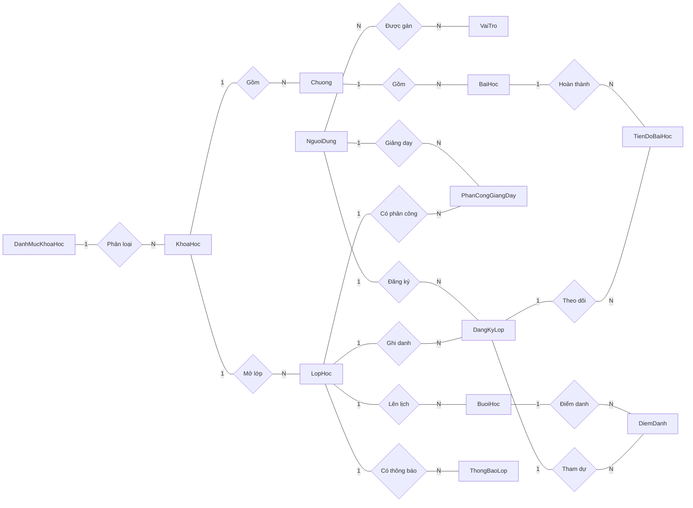
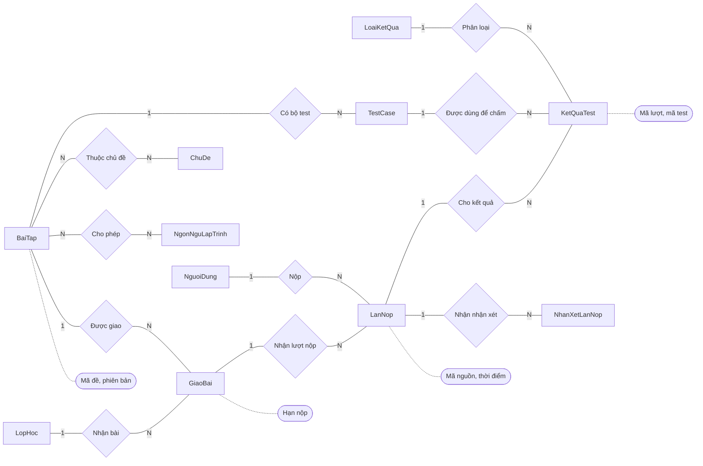
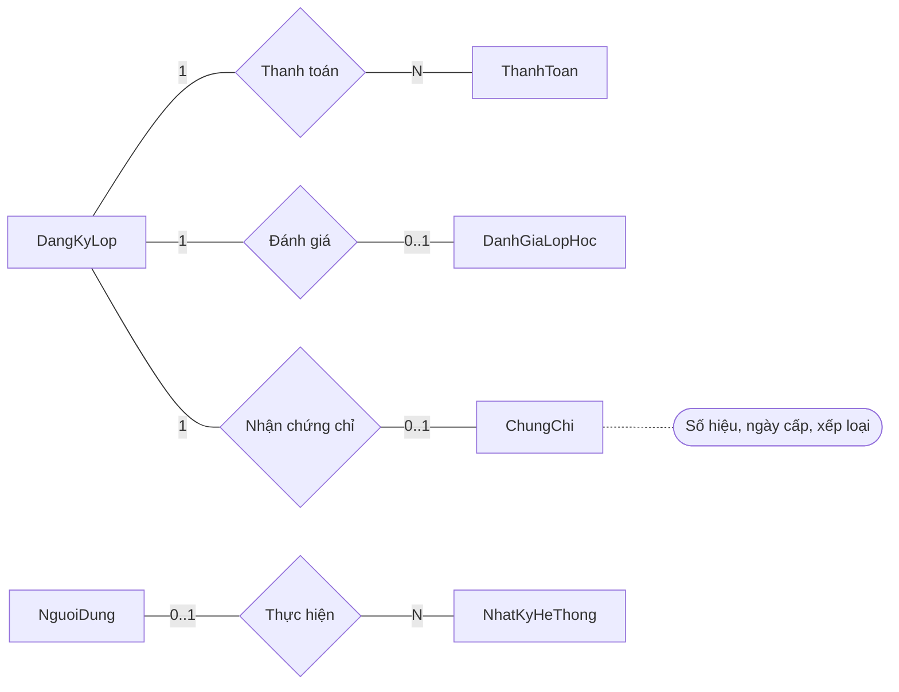

# Mô hình khái niệm Chen

Hình chữ nhật là thực thể. Hình thoi là quan hệ. Nhãn 1, N và 0..1 cho biết số lượng tham gia ở từng đầu. Thực thể kết hợp lưu thông tin của chính quan hệ, ví dụ ghi danh có trạng thái và lần nộp có mã nguồn. Chỉ đưa các thuộc tính định danh tiêu biểu vào hình. Đặc tả đầy đủ nằm trong lược đồ SQL.

## Đào tạo và tổ chức lớp

## Bài thực hành, lượt nộp và chấm điểm

## Học phí, phản hồi và chứng chỉ

Hai quan hệ N–N của ngân hàng bài chuyển thành `BaiTapChuDe` và `BaiTapNgonNgu`. Quan hệ gán vai trò chuyển thành `NguoiDungVaiTro`. [Sơ đồ quan hệ](erd-quan-he.md) thể hiện đầy đủ các khóa ngoại và quan hệ phụ.
