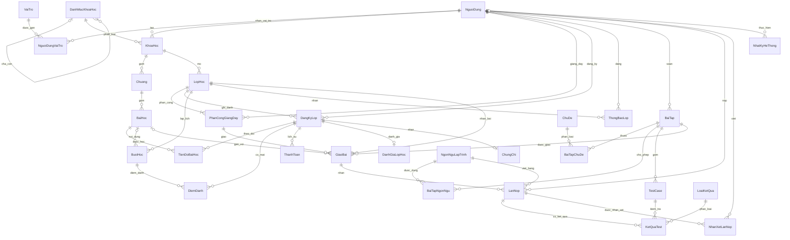

# Lược đồ quan hệ Crow’s Foot

Bội số `|o` ở phía cha biểu diễn khóa ngoại cho phép NULL. Lớp có một phân công chính và có thể thêm trợ giảng. Quan hệ `GiaoBai → PhanCongGiangDay` dùng khóa ghép `(ma_lop, ma_nguoi_giao)`. Quan hệ logic giữa lớp và ghi danh của một lượt nộp được xác minh bằng trigger vì `LanNop` suy ra lớp từ `GiaoBai`.

Lược đồ SQL khai báo cột, kiểu dữ liệu và ràng buộc. Danh mục bảng giải thích khóa chính, khóa ngoại và các ràng buộc duy nhất theo từng nhóm nghiệp vụ. [Lược đồ lõi](../database/01_schema.sql) · [Bảng xác thực email](../database/14_xac_thuc_tai_khoan.sql) · [Danh mục bảng](bang-va-truy-cap-co-so-du-lieu.md)
