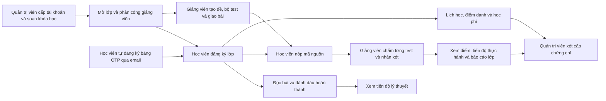
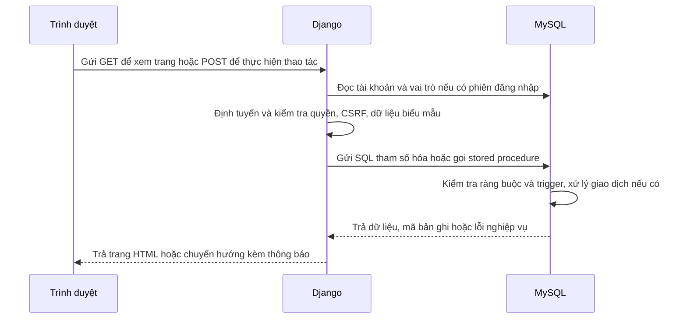
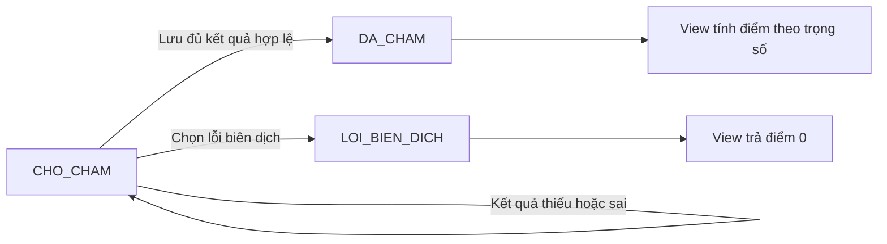

# Luồng xử lý toàn bộ dự án CodeLab

CodeLab quản lý khóa học lập trình theo lớp. Quản trị viên chuẩn bị nội dung và mở lớp. Giảng viên điều hành lớp, giao đề và chấm bài. Học viên tự đăng ký qua email, đọc bài, nộp mã nguồn và theo dõi kết quả. Django xử lý giao diện và quyền truy cập. MySQL lưu dữ liệu, kiểm tra điều kiện nghiệp vụ và tính các báo cáo.

Tài liệu mô tả phiên bản website hiện tại. Kết quả chấm do người có quyền nhập hoặc sinh ngẫu nhiên trong chế độ giả lập. Học phí được ghi nhận dưới dạng giao dịch giả lập.

## 1. Luồng sử dụng tổng thể

| Vai trò | Thao tác chính |
| --- | --- |
| Khách | Tìm khóa đã công bố, xem chương trình và lớp còn chỗ, học thử bài đầu tiên, tự đăng ký học viên hoặc yêu cầu đặt lại mật khẩu qua email. |
| Học viên | Đăng ký hoặc hủy đăng ký lớp, đọc bài, đánh dấu hoàn thành, nộp mã, xem kết quả và nhận xét, theo dõi tiến độ, ghi nhận học phí và đánh giá lớp khi đủ điều kiện. |
| Giảng viên | Quản lý các lớp được phân công, thêm buổi và thông báo, điểm danh, soạn đề, giao bài, chấm, nhận xét và xem báo cáo. |
| Quản trị viên | Cấp tài khoản và vai trò, soạn khóa/chương/bài, mở và sửa lớp, phân công, xem báo cáo, quản lý học phí, cấp chứng chỉ và xem nhật ký. Quản trị viên có quyền chấm, nhưng quyền giao bài và nhận xét yêu cầu vai trò giảng viên và phân công trên lớp. |

## 2. Một yêu cầu đi qua hệ thống như thế nào

- **Giao diện:** Các template trong `web/templates` dựng HTML. CSS và JavaScript tĩnh phục vụ bố cục và biểu đồ. Người dùng gửi biểu mẫu qua các route trong `web/config/urls.py`.
- **Django:** Các module trong `web/apps` kiểm tra vai trò, phạm vi lớp hoặc quyền sở hữu bản ghi. Biểu mẫu được kiểm tra trước khi gọi `fetch_one`, `fetch_all`, `execute` hoặc `call_proc` trong `web/core/db.py`.
- **MySQL:** Mã nguồn dùng SQL tham số hóa trên lược đồ `btlcsdl`. Khóa ngoại, khóa duy nhất, `CHECK` và trigger bảo vệ dữ liệu. Stored procedure xử lý thao tác nghiệp vụ. View tổng hợp điểm, sĩ số, tiến độ, công nợ và chuyên cần khi đọc.
- **Phản hồi:** Sau khi ghi thành công, các biểu mẫu thường chuyển hướng sang trang đích. Nếu MySQL trả lỗi nghiệp vụ, Django chuyển lỗi thành thông báo phù hợp qua `web/core/errors.py`. Khi truy cập ngoài phạm vi quyền, trang có thể trả 403 hoặc 404 tùy cách kiểm tra của route.

[Route Django](../web/config/urls.py) · [Lớp gọi SQL](../web/core/db.py) · [Xử lý lỗi MySQL](../web/core/errors.py)

## 3. Tài khoản và quyền

1. Quản trị viên vào **Người dùng → Tạo tài khoản**. Django băm mật khẩu bằng bcrypt. `sp_tao_nguoi_dung` ghi `NguoiDung` và vai trò ban đầu trong `NguoiDungVaiTro` trong cùng một giao dịch. Màn hình **Gán vai trò** có thể thêm vai trò cho tài khoản đã có.
2. Khi đăng nhập, Django tìm tài khoản đang hoạt động và so sánh mật khẩu với bản băm. Nếu hợp lệ, Django lưu mã người dùng cùng dấu xác thực gắn với mật khẩu trong phiên ký số.
3. Với yêu cầu tiếp theo, `AppUserMiddleware` đọc mã người dùng trong phiên, tải lại vai trò và gắn vào `request.actor`. Route dành cho giảng viên kiểm tra thêm `PhanCongGiangDay`. Trang của học viên kiểm tra mã người sở hữu đăng ký hoặc lượt nộp.
4. Khi đã có tài khoản hợp lệ, middleware đặt `@app_user_id` trên kết nối MySQL để trigger nhật ký gắn được người thực hiện. **Đăng xuất** xóa phiên đăng nhập.

| Tài khoản kết nối MySQL | Cách sử dụng |
| --- | --- |
| `app_web` | Tài khoản web đọc bảng và view cần thiết, gọi procedure và ghi trực tiếp vào một số bảng được cấp quyền. Quyền của từng người dùng website được Django kiểm tra theo vai trò và phạm vi dữ liệu. |
| `app_readonly` | Kết nối riêng để chạy bộ kiểm thử truy vấn và đo kế hoạch thực thi. Có quyền đọc theo danh sách cấp quyền và quyền `SHOW VIEW`. |

### Đăng ký học viên và quên mật khẩu

1. Từ trang đăng nhập, người dùng nhập email tại **Tạo tài khoản học viên** hoặc **Quên mật khẩu**. Django kiểm tra hạn mức rồi gửi OTP qua SMTP. Trong chế độ phát triển với SMTP chưa cấu hình, thư được lưu trong `.local/mail`.
2. `MaXacThucEmail` lưu HMAC của mã, mục đích, thời điểm hết hạn và số lần nhập sai. Phiên trình duyệt lưu mã yêu cầu. OTP có hiệu lực 10 phút, tối đa 5 lần nhập sai và dùng một lần. `HanMucXacThuc` quản lý giới hạn gửi theo email và IP.
3. Khi người dùng nhập đúng mã và mật khẩu, Django khóa bản ghi OTP trong giao dịch. Đăng ký gọi `sp_dang_ky_hoc_vien_xac_thuc` để tạo tài khoản với vai trò `HOC_VIEN`. Đặt lại mật khẩu cập nhật bản băm của tài khoản đang hoạt động đã yêu cầu mã. Sau khi lưu thành công, giao dịch xóa yêu cầu OTP.
4. Mật khẩu mới làm thay đổi dấu xác thực của tài khoản. Lần truy cập tiếp theo từ phiên cũ sẽ được chuyển đến trang đăng nhập.

[Quản lý tài khoản](../web/apps/accounts.py) · [Luồng xác thực email](../web/apps/account_flows.py) · [Nghiệp vụ OTP](../web/core/email_otp.py) · [Hai bảng xác thực](../database/14_xac_thuc_tai_khoan.sql)

## 4. Tạo khóa học, mở lớp và ghi danh

### Khóa học và lớp học

**Khóa học** là chương trình gồm các chương và bài học. **Lớp học** là một đợt tổ chức của khóa đó, có lịch bắt đầu/kết thúc, sĩ số, học phí, giảng viên và trạng thái hoạt động riêng. Chẳng hạn, PY01 và PY02 cùng sử dụng nội dung **Python cơ bản**, còn mỗi lớp có ghi danh và bài giao riêng.

1. Quản trị viên tạo `KhoaHoc`, thêm `Chuong` và `BaiHoc`, rồi đặt trạng thái **Công bố** để khóa xuất hiện trong danh mục công khai.
2. Tại **Lớp học → Mở lớp mới**, `sp_tao_lop` tạo `LopHoc` và phân công giảng viên chính trong cùng giao dịch. Khi sửa lớp, `sp_sua_lop` kiểm tra sĩ số đã ghi danh và các khoản học phí đã thu trước khi cho giảm sĩ số tối đa hoặc học phí.
3. Quản trị viên dùng `sp_phan_cong_giang_vien` để phân công giảng viên chính hoặc trợ giảng. Khóa duy nhất trên cột sinh `la_chinh` giới hạn mỗi lớp tối đa một giảng viên chính. Khi chọn người chính mới, procedure chuyển người chính cũ thành trợ giảng.

### Khám phá khóa học và đăng ký lớp

1. Tại `/khoa-hoc/`, khách xem các khóa đã công bố và lọc theo tên, mã, danh mục hoặc trình độ. Trang chi tiết hiển thị chương trình, bài đầu để học thử và các lớp mở còn chỗ.
2. Học viên chọn lớp và gửi đăng ký từ `/lop/<class_id>/dang-ky/`. Django kiểm tra vai trò học viên và trạng thái công bố của khóa. Tác vụ ghi gọi `sp_dang_ky_lop`.
3. MySQL khóa hàng lớp bằng `SELECT ... FOR UPDATE`, kiểm tra trạng thái mở, ghi danh trùng và số chỗ. Nếu đủ điều kiện, procedure tạo `DangKyLop` hoặc kích hoạt lại bản ghi đã hủy. Cặp `(ma_lop, ma_hoc_vien)` là duy nhất.
4. Hai yêu cầu tranh chỗ cuối được xử lý lần lượt trên cùng hàng lớp. Yêu cầu đến sau đếm lại số chỗ sau khi có khóa. Khi hủy, `sp_huy_dang_ky` chuyển ghi danh đang học sang `DA_HUY`, nhờ đó lịch sử được giữ và ghế được trả lại.

[Danh mục và nội dung](../web/apps/courses.py) · [Quản lý lớp](../web/apps/classes.py) · [Procedure lớp và ghi danh](../database/05_procedures.sql)

## 5. Học lý thuyết và điều hành lớp

### Đọc bài và lưu tiến độ

- **Học thử:** Route `/khoa-hoc/<course_id>/hoc-thu/<lesson_id>/` kiểm tra quyền nhìn thấy khóa. Khách và học viên dùng chế độ học thử mở được bài đầu tiên. Quản trị viên mở được từng bài để xem trước.
- **Vào học:** Route `/lop/<class_id>/bai-hoc/<lesson_id>/` kiểm tra học viên có ghi danh còn hiệu lực và bài thuộc đúng khóa của lớp. Trang hiển thị mục lục và nút chuyển bài. **Học tiếp** trên trang khóa học dẫn đến bài chưa hoàn thành đầu tiên theo thứ tự chương và bài.
- **Hoàn thành:** Khi học viên bấm nút, Django ghi `TienDoBaiHoc` theo cặp `(ma_dang_ky, ma_bai_hoc)`. Gửi lại cùng thao tác giữ nguyên mốc hoàn thành đã có. Trigger kiểm tra bài học thuộc khóa của lớp. `v_tien_do_ly_thuyet` tính số bài đã hoàn thành chia cho tổng số bài của khóa.

### Lịch, thông báo và điểm danh

- Giảng viên được phân công hoặc quản trị viên thêm lịch vào `BuoiHoc` và thông báo vào `ThongBaoLop`. Học viên đã ghi danh xem chúng tại trang lớp.
- Để điểm danh, mở buổi học và chọn học viên. Django thêm hoặc cập nhật `DiemDanh` theo cặp buổi học và ghi danh. Trigger kiểm tra hai bản ghi thuộc cùng lớp và ghi danh còn hiệu lực.
- `v_chuyen_can` chỉ tính các buổi đã kết thúc. Trạng thái `CO_MAT` và `MUON` được tính vào số buổi có mặt. Nếu lớp chưa có buổi kết thúc, tỷ lệ chuyên cần là `NULL`.

[Màn hình bài học](../web/apps/lessons.py) · [Lịch và điểm danh](../web/apps/classes.py) · [View tiến độ](../database/04_views.sql)

## 6. Soạn đề và giao bài thực hành

1. Giảng viên hoặc quản trị viên mở **Ngân hàng bài tập**. `sp_tao_bai_tap` tạo `BaiTap`, ngôn ngữ được phép trong `BaiTapNgonNgu` và chủ đề nếu có. Người soạn thêm từng `TestCase` với đầu vào, đáp án, trọng số và cờ test mẫu. Quản trị viên và tác giả có quyền chỉnh đề trong phạm vi được phép.
2. Tại **Lớp học → Giao bài**, giảng viên được phân công chọn một phiên bản đề đã có test. Người giao chọn hạn nộp, cờ bắt buộc, số lượt tối đa nếu cần và có thể gắn bài lý thuyết liên quan.
3. Django gọi `sp_giao_bai` để tạo `GiaoBai`. Khóa ngoại ghép bảo đảm người giao thuộc phân công của lớp. Trigger kiểm tra bộ test và xác nhận bài lý thuyết gắn kèm thuộc khóa của lớp. Một lớp chỉ có một bản ghi giao cho cùng phiên bản đề.
4. Sau lượt nộp đầu tiên, trigger khóa thay đổi đề và bộ test đã dùng. Tác giả hoặc quản trị viên chọn **Tạo phiên bản mới** để sao chép đề, ngôn ngữ, chủ đề và test. Bài giao cũ tham chiếu phiên bản đã lưu nên dữ liệu lịch sử vẫn đối chiếu được.

| Dữ liệu | Ý nghĩa |
| --- | --- |
| `BaiTap` | Đề dùng lại được, có mã đề và số phiên bản. |
| `GiaoBai` | Một đề được giao cho một lớp, có hạn nộp và chính sách riêng. |
| `LanNop` | Một lần gửi mã nguồn của một học viên cho một bài giao. |
| `KetQuaTest` | Một kết quả trên một test của một lần nộp. Khóa chính là `(ma_lan_nop, ma_test)`. |

[Ngân hàng đề và giao bài](../web/apps/exercises.py) · [Procedure tạo đề và tạo phiên bản](../database/05_procedures.sql) · [Trigger bảo vệ bộ test](../database/06_triggers.sql)

## 7. Nộp mã, chấm từng test và nhận xét

### Học viên nộp mã nguồn

1. Học viên vào **Lớp học → Bài thực hành**, chọn bài để mở `/giao-bai/<assignment_id>/nop/`. Trang hiển thị đề, hạn, ngôn ngữ được phép, các test mẫu và lịch sử nộp của chính học viên.
2. Khi bấm **Gửi bài**, Django kiểm tra biểu mẫu và gọi `sp_nop_bai` với mã bài giao, mã học viên từ phiên, ngôn ngữ và mã nguồn.
3. Trigger `trg_lannop_bi` khóa bài giao để kiểm tra giới hạn lượt ngay cả khi có nhiều yêu cầu. MySQL kiểm tra ghi danh đang học, lớp còn nhận bài, thời gian giao và hạn nộp, bộ test, ngôn ngữ hợp lệ và mã nguồn có nội dung.
4. Nếu hợp lệ, MySQL thêm `LanNop` với trạng thái `CHO_CHAM` và trả mã lượt. Django chuyển học viên đến trang kết quả của lượt đó. Mỗi lần nộp có mã riêng và xuất hiện trong lịch sử.

### Giảng viên chấm

1. Tại `/cho-cham/`, giảng viên thấy các lượt `CHO_CHAM` thuộc lớp được phân công. Quản trị viên có thể xem hàng đợi của các lớp. Chọn mã lượt rồi bấm **Chấm giả lập**.
2. Django đọc các test của đúng phiên bản đã giao. Chế độ thủ công cho chọn mã như `AC` hoặc `WA` cho từng test. **Chấm ngẫu nhiên** sinh mã kết quả mẫu. **Lỗi biên dịch** gọi `sp_loi_bien_dich` để chốt một lượt đang chờ.
3. Khi lưu kết quả từng test, Django gửi mảng JSON đến `sp_ghi_ket_qua_cham`. Procedure khóa hàng `LanNop`, xác nhận lượt đang chờ, kiểm tra cấu trúc JSON và chuyển dữ liệu bằng `JSON_TABLE`. Trigger kiểm tra test thuộc đúng đề. Khóa ghép bảo đảm mỗi test xuất hiện một lần.
4. Khi số kết quả hợp lệ bằng số test của đề, procedure lưu trạng thái `DA_CHAM` và thời điểm chấm rồi commit. Nếu thiếu test, trùng test hoặc có dữ liệu sai, giao dịch rollback và lượt giữ trạng thái chờ chấm. Khóa hàng và điều kiện trạng thái giúp chặn việc chấm lại cùng lượt đã chốt.

Giảng viên được phân công có thể lưu lời góp ý vào `NhanXetLanNop`, kèm số dòng mã nếu muốn. Chủ lượt nộp, giảng viên được phân công và quản trị viên được xem kết quả theo quyền. Học viên xem mã kết quả của từng test, còn mô tả test ẩn hiển thị là **Test ẩn**. Dữ liệu vào và đáp án của test ẩn nằm trong màn hình chấm.

[Màn hình nộp, chấm và nhận xét](../web/apps/submissions.py) · [Procedure chấm](../database/05_procedures.sql) · [Trigger kiểm tra lần nộp](../database/06_triggers.sql)

## 8. Điểm, báo cáo và tiến độ

| Cần xem | Dữ liệu và quy tắc tính |
| --- | --- |
| Điểm một lần nộp | `v_diem_lan_nop` tính `100 × tổng trọng số test đúng ÷ tổng trọng số của cả bộ test`, làm tròn hai chữ số. Một lượt **Đạt** khi đúng toàn bộ test trong lượt đó. Lượt chờ chấm hiển thị điểm trống. Lượt lỗi biên dịch có điểm 0. |
| Điểm tốt nhất theo bài | `v_trang_thai_hoc_vien_bai_giao` lấy điểm cao nhất qua các lượt của cùng học viên và bài giao. Bài được tính **Đạt** nếu có ít nhất một lượt đúng toàn bộ test. |
| Thống kê bài giao | `v_thong_ke_bai_giao` tổng hợp lượt nộp, người đã thử, đạt, chưa đạt, chưa nộp và người còn chờ kết quả đầu tiên. Tập học viên lấy từ ghi danh để vẫn có dòng cho người chưa gửi bài. |
| Test thường sai | `v_loi_lan_gan_nhat` chọn kết quả chốt gần nhất của mỗi học viên trên từng bài theo thời điểm chấm và mã lượt. Kết quả từng test được đếm khi lượt được chọn ở trạng thái `DA_CHAM`. |
| Tiến độ thực hành | `v_tien_do_thuc_hanh` lấy số bài bắt buộc đã đạt chia cho số bài bắt buộc đã giao đến thời điểm hiện tại. Nếu chưa có bài bắt buộc, tỷ lệ là `NULL` và giao diện báo chưa có dữ liệu. |
| Bảng điểm lớp | Django gọi `sp_bao_cao_lop` để lấy xếp hạng, người chưa nộp và lỗi gần nhất. Bảng điểm pivot dùng mỗi bài giao làm một cột, tối đa 30 bài. Xếp hạng ưu tiên số bài bắt buộc đã đạt rồi đến điểm tốt nhất trung bình theo bài. |

Học viên xem kết quả cá nhân tại **Tiến độ của tôi** và lịch sử trong mỗi bài giao. Giảng viên hoặc quản trị viên mở bài giao để xem [thống kê PY01](http://127.0.0.1:8000/giao-bai/1/thong-ke/) hoặc vào **Bảng điểm** tại trang lớp để xem theo học viên. Trang tổng quan của học viên tóm tắt các lớp và bài bắt buộc, trang nhân sự hiển thị số liệu theo vai trò và hoạt động nộp trong bảy ngày gần nhất. [Các view báo cáo](../database/04_views.sql) · [Màn hình báo cáo](../web/apps/reports.py) · [Trang tổng quan](../web/apps/dashboard.py)

## 9. Học phí, đánh giá, chứng chỉ và nhật ký

### Học phí và đánh giá

- Tại **Tiến độ của tôi**, học viên mở đăng ký của mình để ghi số tiền, phương thức và mã giao dịch nếu có. `sp_thanh_toan` ghi `ThanhToan`. Trigger khóa dữ liệu lớp và ghi danh liên quan để kiểm tra tổng các khoản thành công không vượt học phí.
- `v_cong_no_hoc_phi` tính tiền còn nợ bằng học phí trừ tổng khoản có trạng thái `THANH_CONG`. Học viên xem số dư cá nhân. Quản trị viên xem công nợ ở **Học phí & chứng chỉ**.
- Khi lớp kết thúc hoặc ghi danh đã hoàn thành, học viên có thể ghi một đánh giá gồm 1–5 sao và nhận xét tùy chọn. `DanhGiaLopHoc` dùng mã ghi danh làm khóa chính, còn trigger kiểm tra điều kiện đã học xong.

### Cấp chứng chỉ

Quản trị viên chọn **Kiểm tra và cấp** ở dòng ghi danh. `sp_cap_chung_chi` khóa ghi danh còn hiệu lực, kiểm tra lớp có bài bắt buộc, học viên đạt tất cả các bài đó và có ít nhất một buổi đã kết thúc với chuyên cần từ 80%. Mỗi ghi danh được cấp tối đa một chứng chỉ. Procedure tạo số hiệu và ghi xếp loại `XUAT_SAC` khi chuyên cần 100%, các trường hợp đủ điều kiện còn lại có xếp loại `DAT`. Học viên xem chứng chỉ trong **Tiến độ của tôi**.

### Nhật ký hệ thống

Trigger ghi nhật ký khi thêm, sửa hoặc xóa các bản ghi thuộc `DangKyLop`, `GiaoBai` và `ThanhToan`. Dữ liệu gồm bảng, thao tác, khóa bản ghi, ảnh chụp các trường chính trước/sau, thời điểm và người thực hiện nếu kết nối đã đặt `@app_user_id`. Quản trị viên xem 100 bản ghi gần đây tại `/nhat-ky/`.

[Tiến độ, học phí và chứng chỉ](../web/apps/finance.py) · [Trigger tài chính và nhật ký](../database/06_triggers.sql)

## 10. Chạy và kiểm tra một vòng nghiệp vụ

Trong thư mục dự án, chạy `.\scripts\start_local.ps1` trong PowerShell, rồi mở [CodeLab trên localhost](http://127.0.0.1:8000/). Cấu hình cục bộ mặc định dùng MySQL cổng `33317`. Lần cài mới, các script SQL đánh số tạo lược đồ, quyền và dữ liệu mẫu. Script `13_noi_dung_khoa_hoc.sql` bổ sung nội dung của hai khóa mẫu. [Hướng dẫn cài và cấu hình](../README.md)

| Bước | Thao tác | Kết quả đối chiếu |
| --- | --- | --- |
| 1 | Chưa đăng nhập, mở [Khóa học](http://127.0.0.1:8000/khoa-hoc/), chọn **Python cơ bản → Học thử**. | Bài đầu có giải thích, ví dụ mã, thực hành và tự kiểm tra. |
| 2 | Dùng `an`, chọn **Python cơ bản → Học tiếp** rồi đánh dấu một bài chưa hoàn thành. | Số bài lý thuyết đã học tăng một. Mở lại cùng bài để kiểm tra mốc hoàn thành. |
| 3 | Dùng `dung`, mở [bài giao của PY02](http://127.0.0.1:8000/giao-bai/2/nop/), chọn Python và gửi mã nguồn. | Có mã lượt mới với trạng thái **Chờ chấm** nếu bài còn mở và còn lượt nộp. |
| 4 | Dùng `trogiang`, mở [Chờ chấm](http://127.0.0.1:8000/cho-cham/), chọn đúng mã vừa tạo. Chấm bốn test `AC`, một test `WA`. | Lượt mẫu có năm test trọng số bằng nhau nên nhận 80%. Dung xem được mã lỗi và điểm trong lịch sử. |
| 5 | Nộp lại ở PY02 và chấm cả năm test `AC`. | Lượt mới đạt 100%. Cả hai lượt đều còn trong lịch sử và báo cáo tính bài là **Đạt**. |

Tài khoản mẫu dùng chung mật khẩu `giá trị CODELAB_DEMO_PASSWORD trong .env`. Hạn nộp mẫu tính theo thời điểm khởi tạo dữ liệu. Trên dữ liệu PY01 ban đầu, bảng thống kê có 3 lượt từ 2 học viên. An đạt 100%, Bình 80%, Chi chưa nộp. Dùng PY02 cho các lượt thử mới để giữ kết quả đối chiếu của PY01.

| Kiểm tra | File hoặc lệnh |
| --- | --- |
| Màn hình, học thử, tiến độ, phân quyền và 35 truy vấn cùng kế hoạch `EXPLAIN` | `.\.venv\Scripts\python.exe web/scripts/check_web.py` |
| Đăng ký, quên mật khẩu, OTP hết hạn và thu hồi phiên cũ | `.\.venv\Scripts\python.exe web/scripts/check_accounts.py` |
| Hai học viên tranh một chỗ | `.\.venv\Scripts\python.exe web/scripts/race_dang_ky.py`. Lệnh tạo một lớp thử và xác nhận chỉ có một người ghi danh. |
| Luật nghiệp vụ, dữ liệu mẫu và rollback kết quả chấm | Chạy [`kiem_thu_kich_ban.sql`](../database/tests/kiem_thu_kich_ban.sql) qua MySQL CLI trên dữ liệu kiểm thử. |
| Đo truy vấn trên dữ liệu khối lượng lớn | Dùng `scripts/benchmark_plans.py` trên lớp mẫu PY-BENCH. [Hướng dẫn đo và đọc kết quả](toi-uu.md) |

## 11. Vị trí tra cứu mã nguồn

| Muốn tìm | Vị trí |
| --- | --- |
| Đường dẫn, tên route và hàm được gọi | [`web/config/urls.py`](../web/config/urls.py) |
| Quy tắc xác thực, phân quyền và tham số SQL | [`web/core/`](../web/core/) |
| Xử lý nghiệp vụ của từng màn hình | [`web/apps/`](../web/apps/) |
| Giao diện HTML và tài nguyên tĩnh | [`web/templates/`](../web/templates/) · [`web/static/`](../web/static/) |
| Lược đồ 28 bảng nghiệp vụ và một bảng nhật ký, khóa và chỉ mục | [`01_schema.sql`](../database/01_schema.sql) · [`02_indexes.sql`](../database/02_indexes.sql) |
| Hàm, view, procedure, trigger và quyền MySQL | [`03_functions.sql`](../database/03_functions.sql) · [`04_views.sql`](../database/04_views.sql) · [`05_procedures.sql`](../database/05_procedures.sql) · [`06_triggers.sql`](../database/06_triggers.sql) · [`07_security.sql`](../database/07_security.sql) |
| Quan hệ giữa các bảng và lý do chuẩn hóa | [ERD quan hệ](erd-quan-he.md) · [Báo cáo kỹ thuật](bao-cao.md) |
